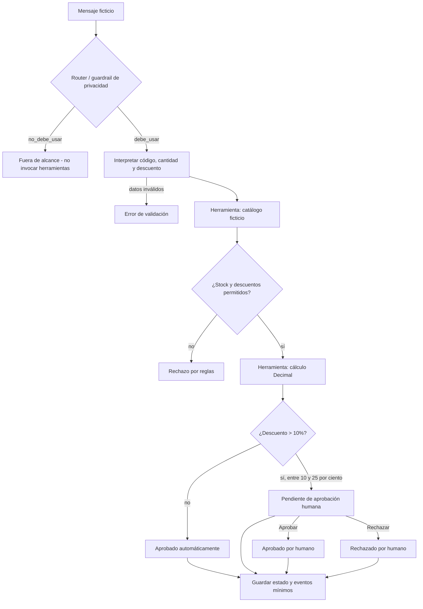

# ALKOSTOPLUS Lab | Cotizador Seguro (workflow académico)

> **Datos 100% simulados.** Esta aplicación es un proyecto educativo independiente: no se conecta a sistemas reales de ALKOSTOPLUS ni utiliza datos reales de clientes, precios reales o claves de API.

## 1. Problema y usuario

**Problema.** En un proceso manual de cotizaciones es fácil ofrecer un producto inexistente, superar el inventario disponible, aplicar un descuento excesivo o aprobar una operación que requiere revisión. También es necesario que preguntas ajenas al comercio y peticiones de datos sensibles no activen herramientas.

**Usuario objetivo.** Personal de mostrador y persona revisora de cotizaciones de una **tienda ficticia de tecnología**. El prototipo muestra cómo preservar control y trazabilidad sin manejar datos personales.

**Solución.** Workflow local que clasifica mensajes en `debe_usar` y `no_debe_usar`, interpreta códigos y cantidades, consulta un catálogo simulado, calcula precios con precisión decimal, aplica límites y solicita **aprobación humana explícita** para descuentos mayores al 10% y hasta el 25%.

## 2. ¿Por qué workflow y no agente autónomo?

Se eligió un **workflow determinista**, no un agente generativo: los pasos y reglas son conocidos, trazables y verificables. Un agente con modelo de lenguaje añadiría variabilidad y dependencias innecesarias para esta tarea restringida. El workflow no finge usar IA generativa: el razonamiento es mediante enrutamiento, reglas comerciales y control humano codificados.

### Arquitectura (vista completa)



### Los cinco primitivos requeridos

| Primitivo | Implementación funcional | Archivo donde verificar |
|---|---|---|
| **Instrucciones** | Políticas de dominio, privacidad, stock, descuentos y aprobación | `config/politicas.json`; `cotizador/core.py` |
| **Herramientas** | Consulta de catálogo ficticio; parser; cálculo preciso `Decimal`; escritura atómica | `config/catalogo_simulado.json`; `cotizador/core.py` |
| **Memoria** | Memoria de sesión efímera (IDs y productos) y persistencia mínima sin PII | `Cotizador.memoria_sesion`; `ArchivoEstado` |
| **Estado** | Máquina de estados: `FUERA_DE_ALCANCE`, `ERROR_VALIDACION`, `RECHAZADO_REGLA`, `APROBADO_AUTOMATICO`, `PENDIENTE_APROBACION`, `APROBADO_HUMANO`, `RECHAZADO_HUMANO` | `cotizador/core.py`; historial en `estado/solicitudes.json` (local, ignorado por Git) |
| **Control** | Router previo a herramientas; restricciones sobre inventario y descuento; aprobación/rechazo humano con registro y no doble aprobación | `clasificar`, `Cotizador.procesar`, `Cotizador.decidir` |

## 3. Cómo ejecutar paso a paso (Windows, macOS o Linux)

**Requisitos:** Python 3.10 o superior; navegador web moderno. No requiere Docker, cuenta, internet, claves ni instalar paquetes externos.

1. Descargar o clonar este repositorio; abrir una terminal dentro de la carpeta raíz.
2. Iniciar el servidor local:

```bash
python -m cotizador.webserver
```

3. Abrir **http://127.0.0.1:8765** en el navegador.
4. Pulsar «Caso normal» y luego «Ejecutar solicitud». Se verá la cotización autorizada.
5. Pulsar «Error de inventario», ejecutar y comprobar el rechazo.
6. Pulsar «Aprobación humana», ejecutar y observar el estado `PENDIENTE_APROBACION`. Escribir un **responsable ficticio** y pulsar «Aprobar» o «Rechazar».
7. Pulsar «Datos sensibles» para comprobar que el router **no utiliza herramientas**.
8. Finalizar el servidor con `Ctrl+C`.

**Si tu Windows usa el lanzador `py`:** sustituye `python` por `py` en los comandos.

### CLI: demo equivalente y reproducible

```bash
# Consultar catálogo ficticio
python -m cotizador catalogo

# Router previo a herramientas
python -m cotizador ruta --mensaje "¿Qué tiempo hará mañana?"

# Caso normal: total ficticio 2945.00 BOB
python -m cotizador procesar --mensaje "Cotiza 2 unidades de CEL-A1 con 5% de descuento"

# Error: cantidad superior al stock disponible
python -m cotizador procesar --mensaje "Cotiza 99 unidades de ACC-C1"

# Control: NO se aprueba automáticamente
python -m cotizador procesar --mensaje "Cotiza 1 unidad de TAB-T1 con 15% de descuento"

# Copiar el id SOL-XXXXXXXXXX de la respuesta anterior:
python -m cotizador decidir --id SOL-XXXXXXXXXX --decision aprobar --responsable "Revisor de demostración"
```

Los estados de cotización se almacenan localmente en `estado/solicitudes.json`, **no se suben** al repositorio (ver `.gitignore`). Se conserva el código de producto y los datos operativos mínimos, no el mensaje original.

## 4. Pruebas, porcentaje de acierto y errores

Ejecutar desde la raíz:

```bash
python -m unittest discover -s tests -v
python -m cotizador evaluar --guardar resultados/evaluacion.json
```

**Resultado de la última ejecución verificada para esta entrega:**

- **22 pruebas unitarias/integración:** 22 correctas.
- **14 casos de evaluación `debe_usar` / `no_debe_usar`:** 14 acertados.
- **Porcentaje = 14 / 14 × 100 = 100 %.** Es una evaluación sobre un conjunto sintético pequeño y predefinido, **no una estimación de precisión general**.
- Hay casos normales, errores de validación, stock insuficiente, privacidad, descuentos rechazados, aprobación y rechazo humano.

Ver el registro exacto en [`resultados/ejecucion_unittest.txt`](resultados/ejecucion_unittest.txt) y la tabla de casos en [`docs/PRUEBAS_Y_MEJORAS.md`](docs/PRUEBAS_Y_MEJORAS.md) o [`resultados/evaluacion.json`](resultados/evaluacion.json).

## 5. Mejoras y control después de la demostración

Durante la elaboración y revisión técnica se incorporaron límites de privacidad, límite absoluto de 25%, estado pendiente y prohibición de doble aprobación. **No se dispone de un registro verificable de la presentación anterior ni de los comentarios del docente**, por lo que estas mejoras **no se atribuyen falsamente** a esa instancia. [`docs/PRUEBAS_Y_MEJORAS.md`](docs/PRUEBAS_Y_MEJORAS.md) distingue ambos puntos.

## 6. Video demo (3 a 5 minutos)

Ver [`entregables/VIDEO_DEMO.mp4`](entregables/VIDEO_DEMO.mp4). Incluye caso normal, caso con error, solicitud fuera de alcance y control humano. Es un video explicativo con **recreación gráfica de salidas reales ejecutadas** (no una grabación de una sesión web), que permite comparar los ejemplos con comandos reproducibles. Guion: [`docs/GUION_VIDEO.md`](docs/GUION_VIDEO.md).

Si el video pesa demasiado para GitHub, cargarlo a YouTube como «No listado», Drive o Loom y poner el enlace aquí.

## 7. Estructura de archivos

```text
ALKOSTOPLUS_Cotizador_Seguro/
├── README.md
├── .env.example                     # Ejemplo de variable; sin secretos
├── .gitignore                       # Excluye estado local y credenciales
├── config/
│   ├── catalogo_simulado.json       # Solo datos inventados
│   └── politicas.json               # Instrucciones y guardrails
├── cotizador/
│   ├── __init__.py
│   ├── __main__.py                   # CLI
│   ├── core.py                       # Router, herramientas, estado y control
│   ├── evaluation.py                 # Evaluación reproducible
│   └── webserver.py                  # Servidor local HTTP sin dependencias
├── web/                              # Interfaz visual
├── tests/test_workflow.py            # 18 pruebas del motor de reglas
├── tests/test_webserver.py           # Pruebas reales de la API HTTP
├── resultados/                       # Evidencia generada
├── docs/                             # Arquitectura, evaluación y guion
├── entregables/VIDEO_DEMO.mp4
└── .github/workflows/pruebas.yml     # CI al subir a GitHub
```

## 8. Seguridad y límites conocidos

- **No se usan API keys** ni servicios remotos. `.env.example` contiene solo una ruta de archivo.
- Nunca introducir clientes ni documentos reales, aun cuando el router bloquee patrones sensibles; su filtro no equivale a una solución integral de protección de datos.
- Monousuario y local: el archivo JSON no está diseñado para accesos simultáneos, autenticación real ni uso comercial.
- El parser de lenguaje natural está limitado a los ejemplos y formatos documentados; no es un modelo LLM.
- Las reglas pueden revisarse en `config/politicas.json`; no hay modificación de inventario ni cobros reales.
- **No se garantiza 100% para solicitudes fuera del conjunto de evaluación**.

## 9. Entrega al docente

1. Crear un repositorio en GitHub y subir **esta carpeta** con el `README.md` en la raíz, preferiblemente en modo público o con lectura habilitada para el docente.
2. Compartir la URL de GitHub y la URL del video, si está alojado fuera del repositorio.
3. En el texto del aula virtual, indicar los nombres **reales** del equipo y pegar los enlaces. Se suministra [`TEXTO_PARA_ENTREGAR.txt`](TEXTO_PARA_ENTREGAR.txt) para completarlos sin inventar datos.

**Integrantes:** pendiente de completar por el equipo.

---
**Licencia de la demostración:** código entregado con fines exclusivamente académicos y educativos. Ninguna cotización representa una oferta comercial real.
